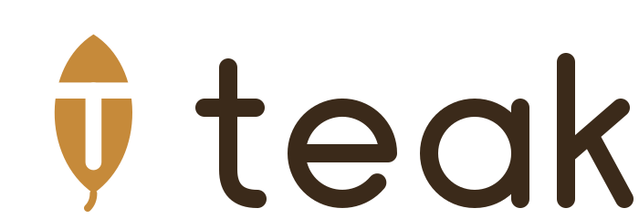

  <picture>
    <source media="(prefers-color-scheme: dark)" srcset="brand/logo-dark.svg">
    
  </picture>

  A programming language with Go's syntax and concurrency, memory safety without a garbage collector, and Scala-style traits.

---

## Status

Teak is in the design phase. There is no compiler yet.

The current work is a set of twenty programs written in a provisional
syntax before any implementation exists. They are the design's test suite:
every rule in the language must let each of them read naturally, and every
stage of the compiler will have to run them all.

## Goals

- **Go's surface.** `func`, `:=`, `go`, channels, `select`, `defer`, slices, maps. A Go developer should read Teak on day one.
- **No garbage collector.** Values have one owner and are freed deterministically. Memory safety is checked at compile time.
- **No lifetime annotations.** Borrows are second class: they can be passed down the call stack but not stored, returned, or sent to another task. That one restriction removes the hardest part of Rust.
- **Data-race freedom.** Anything crossing a task boundary must be moved, immutable, or atomically shared. The compiler infers which types qualify.
- **Traits, not interfaces.** Nominal traits with default methods, fields, and compile-time linearization.
- **Sum types and pattern matching**, with `Option` and `Result` instead of `nil` and exceptions.

## Layout

| Path | Contents |
|---|---|
| [`design/`](design/) | Language design document and syntax conventions |
| [`examples/`](examples/) | The twenty programs, with the open questions they raised |
| [`brand/`](brand/) | Logo, wordmark, and palette |

## Plan

| Stage | What |
|---|---|
| 0 | Lexer and parser for the Go-like syntax, written in Go |
| 1 | Core checker: ownership, moves, `ref`/`mut` borrows, destructors. Emit Go source. |
| 2 | Traits, generics, sum types, `Option`/`Result`. Still emit Go. |
| 3 | Sendable inference for `go` and channels. |
| 4 | LLVM backend and a native runtime with an M:N scheduler. |
| 5 | GPU kernels through the LLVM targets: a kernel-safe subset and device buffers. |

## License

[BSD 3-Clause](LICENSE)
