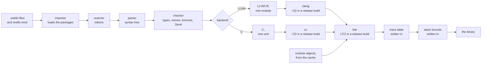
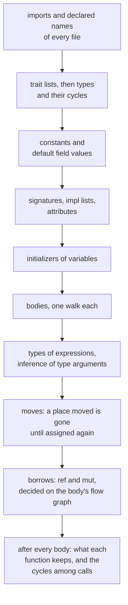
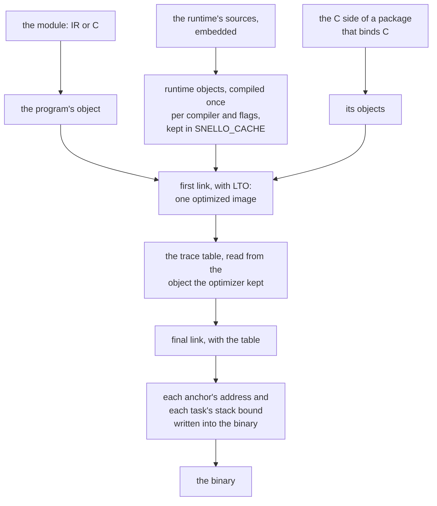

# 39. How the compiler works

`snello` is one program, written in Go, and it carries inside it everything a build needs but the system's C compiler: the standard library's source and the C runtime every program links against. A build is a short sequence of steps, each a package of the compiler, and this chapter walks them in order: what each takes, what it decides and what it hands on. The design notes under `_docs/design/` hold the reasons behind each decision; this chapter is the map.

## The pipeline

Nothing in the pipeline is a daemon or a server: `snello build` runs the steps once, left to right, and exits. The packages of the compiler mirror the Go toolchain's: `token`, `scanner`, `ast` and `parser` follow `go/token`, `go/scanner`, `go/ast` and `go/parser`, and the checker follows `go/types`, so a reader who knows how Go compiles Go knows where to look.

## Loading a program

The importer finds the program's files and every package they import. A program is a file or a directory; the nearest `snello.mod` above it marks the module's root, and an import path names a directory under that root, a package the compiler ships, or a module a `require` line names, fetched by version into the module cache (chapter 35). The standard library is embedded in the compiler: `std/` is read from inside the binary, so a build needs no installation beside `snello` itself; only the library's own tests, run from a checkout, read it from disk. A file's name chooses its platform, as `poll_linux.snello` is built for Linux alone (chapter 34), and the loader keeps the files that match the target.

Each package's files are scanned and parsed into a syntax tree, then checked as one package; a package imported is loaded and checked before the package that imports it, so that every name an import brings is known with its type. The loader's result is the program: its files, their trees, and the checker's tables.

## The checker

The checker decides everything about meaning before any code is written: every expression's type, every move, every borrow, every value that crosses a task. It walks a package's files a phase at a time, so that a declaration in one file is known to every other before any body is entered.

Inside a body the passes run together over one walk. The move pass keeps the set of places moved on each path and forks it at every branch, so that a value moved in one arm of an `if` is gone after it (chapter 5). The borrow pass records every borrow and every use on the body's flow graph and decides where each borrow is live by three passes over the graph, which is how a program never writes a lifetime (chapter 6, and `10-borrow-checking.md` for the algorithm). The same walk classifies each capture of a closure, by copy, by move or as a borrow of one kind or the other (chapter 6). Once every body is walked, the keeping pass finds the parameters each function lets outlive the call, by storing, returning or sending them, since a function keeps what the functions it calls keep. `Send` is a property of a type, computed from its structure where a value crosses a task and never declared (chapter 10). Generic uses are inferred from their arguments and each instance is recorded (chapter 12); the type arguments of every generic call go into the checker's tables, since the backends write one copy per instance.

What leaves the checker is a set of tables keyed by the syntax tree's nodes: the type of each expression, the moves, the captures and whether each is a copy, the instances of generics, and for each function what it keeps. The backends read those tables and decide nothing about ownership themselves; that is the contract `07-lowering.md` records, and it is what lets two backends agree on every program.

## Two backends, one set of rules

A backend turns the checked program into the text of another language and hands it to a compiler that already exists. The C backend writes one C translation unit; it is the reference, the one a new rule is written into first. The LLVM backend writes one LLVM IR module and is the default, since clang reads IR into the same optimizer that compiles the runtime, so the two are optimized as one. Both walk the syntax tree directly, with no intermediate form between the tree and the text: every decision such a form would carry is a rule over the checker's tables, and those rules live in `compiler/emit/lower`, the package both backends share, so that the differential test between them compares two walks of one set of rules.

What a backend decides is the shape of every value in memory, the order of evaluation, where each value is released, and how a panic finds the values still to release. Every function it writes goes in one text section of the program's own, the only code the scheduler takes a task off its worker in (chapter 10): the C library and a package's C side are outside it and are never interrupted. A generic function is written once per instance, from a worklist that ends when no new instance is asked for; a trait's default method is one such instance per implementing type. A library function the runtime provides is declared without a body in `std/` and written as a call into the runtime, under names both backends take from `lower`, since the runtime declares some of them.

## From text to a binary

The runtime is compiled once for each compiler and set of flags and kept in a cache, as Go keeps its build cache: an entry is named by a hash of the runtime's sources and headers, the compiler and the flags, and a build that finds the system headers changed makes the entry anew. A build therefore compiles only the program and links the runtime's objects, which is why the second build on a machine is fast and the first is not.

A release build links with link-time optimization: the program's module and the runtime are compiled to IR and optimized together, so a runtime function a program calls in a loop is written into it in place of the call. Such a build links twice. The first link runs the optimizer and keeps the object it wrote, with its functions and their lines; on Windows the first link's image is read instead, and a build with gcc, which keeps no such object, joins the objects in a partial link. From that the compiler writes the trace table, the one a panic walks to print its frames by name and line (chapter 17), and the final link joins the table in, on Linux stripping the debugging sections a release build has no more use for. Then two things are written into the finished binary in place: each anchor's address for the trace, found by its symbol, and the bound of each task's stack. A debug build links once, its objects native already, each with its line tables, and the table is read from them.

The stack bound is the one analysis that reads the binary rather than the source. After the link, `compiler/emit/stack` reads every function as the system's disassembler prints it, its frame from the instructions that move the stack pointer and the calls it makes, and walks from the runtime's task entry to the deepest path of each spawn, so that most tasks run on a few kilobytes packed beside others and a spawn makes no system call (chapter 10). Whatever it does not understand makes the task unbounded, never smaller, and a failure of the analysis leaves every task on a large guarded stack and never fails a build.

## Debug and release

`snello build -debug` builds the same program for a debugger and for checking:

| | Release | Debug |
|---|---|---|
| The program's functions | optimized, inlined into one another and the runtime | left as written, `optnone`, one frame per function |
| The runtime | optimized with the program, LTO | compiled with its checks, `SN_DEBUG`: the allocator poisons and counts every block, a small stack is checked against its bound as its task ends, a wake that reaches an ended task stops the program |
| At the end | nothing | the blocks still held are reported, chapter 10 |
| Debugging information | none in the binary: the line tables are read for the trace table and left out | full, with the types; `dsymutil` on macOS, visualizers on Windows |
| A panic's trace | the frames the optimizer kept | every frame as written, since the passes that merge or split code are off |

Chapter 32 lists the variables that change where a build reads from.

## The commands

The commands that run the pipeline: `snello build` runs it whole; `snello run` builds and runs; `snello debug` builds for a debugger and starts one; `snello test` generates a main that runs the package's tests and builds that (chapter 16); `snello check` stops after the checker and reports what it found; `snello emit` prints the module a build would compile, IR or C with `-backend c`; `snello lex` and `snello parse` print the tokens and the tree. `snello env` prints what a build reads and where each setting comes from, and `snello doctor` tries each piece of the toolchain as a build uses it. `-target SYSTEM/PROCESSOR` builds for another platform with that platform's system files (chapter 34). Chapter 32 has every command.

## For maintainers

The packages, each with its counterpart in Go's toolchain where it has one:

| Package | What it does | Modeled on |
|---|---|---|
| `compiler/token` | token kinds and positions; a position is a byte offset, resolved to a line only when printed, and every file of one load has positions of its own | `go/token` |
| `compiler/scanner` | the lexer, with Go's semicolon insertion | `go/scanner` |
| `compiler/ast` | the syntax tree | `go/ast` |
| `compiler/parser` | the parser | `go/parser` |
| `compiler/types` | the checker: types, inference, moves, borrows on the flow graph, keeping, closures, `Send`, `fmt` formats | `go/types` |
| `compiler/importer` | loads packages: the embedded library, the module's directories, modules by version, the lock file | `go/importer` |
| `compiler/platform` | the systems and processors, `-target`, the rule that reads a file's name for its platform | Go's `internal/platform` |
| `compiler/version` | the compiler's version and the module file's `snello` line | |
| `compiler/emit/lower` | the rules both backends share: names, what a value needs when dropped, the library functions, the instances | |
| `compiler/emit/c` | the C backend, the reference; the runtime's cache; the link | |
| `compiler/emit/llvm` | the LLVM backend, the default | |
| `compiler/emit/stack` | the bound of each task's stack, read from the linked binary | |
| `compiler/emit/trace` | the trace table of a panic, read from the debugging information and written as an object | |
| `compiler/emit/natvis` | the visualizers a Windows debugger shows a debug build's values by | |
| `compiler/emit/internal/backendtest` | the programs both backends build and run, with what each must give | |
| `compiler/testrun` | the generated main of `snello test` and the runner's output | |
| `compiler/toolchain` | what a build needs from the system, each tried as a build uses it | |
| `runtime/c` | the C runtime: the scheduler, channels, locks, timers, sockets, the allocator, panics | Go's runtime, in C |
| `std` | the standard library, in Snello, embedded | |
| `cmd/snello` | the command | |
| `internal/measure` | runs a program for a test and reports its time and peak memory | |
| `lsp/jsonrpc` | the framing of the language server's messages | |
| `lsp/protocol` | the Language Server Protocol's types the server uses | |
| `lsp/server` | the language server: documents, checks through the importer and the checker, diagnostics, hover and definition (chapter 40) | |
| `cmd/snellols` | the language server's command | |

Three tests hold the whole to one behaviour. The programs under `compiler/emit/internal/backendtest/testdata/`, and the list beside them in Go, are built and run through both backends, in release and debug, and each must print what the list or its `.out` file says, the same for both, so that a rule written into one backend and not the other fails before it is merged; the programs under `examples/`, each with its expected output beside it, are the acceptance suite, every change keeping all of them running; and every package of the standard library is compiled by the importer's tests, so that a change to the checker that refuses a library's program fails there. A change to what a backend decides is written into `07-lowering.md` in the same change, since that note is the record both backends are written against.
